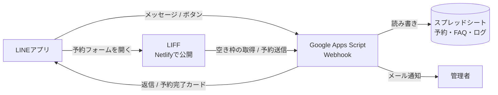

# LINE予約デモ

クラウドソーシング用ポートフォリオの「実際に触れるデモ」です。
QRコードで友だち追加すると、架空の店舗「デモサロン」として、LINE上で予約から確認・キャンセルまでを体験できます。

## できること

| 機能 | 内容 |
|---|---|
| 予約フォーム（LIFF） | LINEの中で開くフォーム。空いている時間だけを表示し、選んで送るだけで予約完了 |
| 予約完了カード | 予約が入ると、日時・メニュー・予約IDをまとめたカードがLINEに届く |
| 予約確認・キャンセル | 「予約確認」で自分の予約がカード一覧で表示され、ボタン1つでキャンセル |
| FAQ自動応答 | 「駐車場」「支払い」などのキーワードに自動で回答。質問と回答はスプレッドシートで編集 |
| リッチメニュー（2タブ） | 「予約メニュー」と「このBotについて」をタブで切り替え |
| 管理者通知 | 予約・キャンセル・相談リクエストを管理者にメールで通知 |
| 排他制御・ログ | 同じ枠への同時予約を防止し、エラーをログシートに記録 |
| デモのリセット | 試した人が自分の予約データを消して、最初からやり直せる |

## 構成



サーバー代はかかりません（GAS・スプレッドシート・Netlify・LINE公式アカウントのいずれも無料枠で動きます）。

## フォルダ構成

```
LINE/
├── gas/                 … Google Apps Script（Webhook・予約処理）
│   ├── Config.gs        … 店舗名・営業時間・メニューなどの設定
│   ├── Main.gs          … Webhook と LIFF からのリクエストの入口
│   ├── Reservation.gs   … 予約台帳・FAQ の読み書き
│   ├── Messages.gs      … LINE に送るメッセージ（Flex Message）
│   ├── Line.gs          … LINE API・通知・ログの共通処理
│   ├── Setup.gs         … 初期設定用の関数
│   └── appsscript.json
├── liff/                … Netlify で公開するフォルダ
│   ├── index.html       … 予約フォーム
│   ├── config.js        … LIFF ID と GAS の URL（要編集）
│   └── richmenu/        … リッチメニュー画像（main.png / info.png）
├── tools/make_richmenu.py … リッチメニュー画像の生成スクリプト
└── netlify.toml
```

---

## セットアップ手順

所要時間は1時間ほどです。**この順番どおりに**進めてください（あとの手順で、前の手順のURLやIDを使います）。

### 準備するもの

- LINEアカウント（LINE Business ID の作成に使います）
- Googleアカウント
- Netlify アカウント（GASの実績資料で使ったもの）

### 1. LINE公式アカウントを作る

1. [LINE Official Account Manager](https://manager.line.biz/) で公式アカウントを作成します（無料のコミュニケーションプランで構いません）。
2. 設定 → **Messaging API** → 「Messaging APIを利用する」をクリックします。
   **プロバイダー**を新しく作成します（例：`arcdamour`）。手順2で同じプロバイダーを使うので、名前を控えておきます。
3. 設定 → **応答設定** で、次のとおりにします。
   - 応答メッセージ：**オフ**
   - あいさつメッセージ：**オフ**（Botが代わりに送ります）
   - Webhook：**オン**

### 2. LINE Developers でチャネルの情報を取得する

[LINE Developers コンソール](https://developers.line.biz/console/) を開き、手順1で作ったプロバイダーを選びます。

**Messaging API チャネル**（手順1で自動作成されています）

1. 「Messaging API設定」タブの一番下で、**チャネルアクセストークン（長期）** を発行してコピーします。→ `CHANNEL_ACCESS_TOKEN`

**LINEログイン チャネル**（予約フォーム用に新しく作ります）

1. **同じプロバイダーの中で**「新規チャネル作成」→「LINEログイン」を選びます。
   アプリタイプは「ウェブアプリ」にします。
   ※ プロバイダーが違うとユーザーIDが一致せず、予約完了カードが届きません。
2. 「チャネル基本設定」タブの **チャネルID** をコピーします。→ `LOGIN_CHANNEL_ID`
3. 「チャネル基本設定」タブの「リンクされたLINE公式アカウント」で、手順1のアカウントを選びます。

### 3. 予約フォームを Netlify で公開する（1回目）

1. Netlify で新しいサイトを作り、`LINE` フォルダをデプロイします。
   `netlify.toml` により、`liff` フォルダの中身が公開されます。
2. 公開URLを控えます（例：`https://line-reservation-demo.netlify.app`）。
3. ブラウザで `https://（公開URL）/richmenu/main.png` を開き、画像が表示されることを確認します。

### 4. LIFF アプリを登録する

LINEログイン チャネル → 「LIFF」タブ → 「追加」

| 項目 | 設定値 |
|---|---|
| LIFFアプリ名 | 予約フォーム |
| サイズ | Full |
| エンドポイントURL | 手順3の公開URL（例：`https://line-reservation-demo.netlify.app/`） |
| Scope | `openid` と `profile` にチェック |
| 友だち追加オプション | On (Normal) |

作成後に表示される **LIFF ID** をコピーします。→ `LIFF_ID`

最後に、LINEログイン チャネルの上部にあるステータスを **「開発中」から「公開済み」** に切り替えます。
**開発中のままだと、あなた以外の人は予約フォームを開けません。**

### 5. GAS をセットアップする

1. Googleスプレッドシートを新規作成します（名前の例：「LINE予約デモ」）。
2. 拡張機能 → **Apps Script** を開きます。
3. `gas` フォルダの `.gs` ファイルを、同じ名前で6つ作って中身を貼り付けます（最初からある `コード.gs` は削除します）。
4. プロジェクトの設定（歯車）→「appsscript.json マニフェスト ファイルをエディタで表示する」にチェックを入れ、`appsscript.json` の中身を貼り付けます。
5. プロジェクトの設定 → **スクリプト プロパティ** に次を追加します。

   | プロパティ | 値 |
   |---|---|
   | `CHANNEL_ACCESS_TOKEN` | 手順2のチャネルアクセストークン |
   | `LOGIN_CHANNEL_ID` | 手順2のLINEログイン チャネルID |
   | `LIFF_ID` | 手順4のLIFF ID |
   | `RICHMENU_IMAGE_BASE_URL` | `https://（公開URL）/richmenu` |
   | `ADMIN_EMAIL` | 通知を受け取るメールアドレス（任意） |
   | `PORTFOLIO_URL` | 実績ページのURL（任意。例：`https://gas-automation-portfolio.netlify.app/`） |

6. エディタで `Setup.gs` を開き、関数 **`setupSheets`** を実行します。
   初回は権限の承認を求められます。「詳細」→「（プロジェクト名）に移動」→「許可」で進めます。
   スプレッドシートに「予約」「FAQ」「ログ」の3つのシートができれば成功です。
7. 関数 **`checkSettings`** を実行し、実行ログに「必須の設定はすべて完了しています」と出ることを確認します。
8. 右上の **デプロイ → 新しいデプロイ** → 種類「ウェブアプリ」
   - 次のユーザーとして実行：**自分**
   - アクセスできるユーザー：**全員**

   デプロイ後に表示される **ウェブアプリのURL**（`https://script.google.com/macros/s/…/exec`）をコピーします。

### 6. Webhook を設定する

Messaging API チャネル → 「Messaging API設定」タブ

1. **Webhook URL** に、手順5でコピーしたウェブアプリのURLを貼り付けます。
2. **Webhookの利用** をオンにします。

※「検証」ボタンでエラーが出ることがあります。GASはリダイレクトを挟んで応答するためで、実際のメッセージは正常に届きます。手順9の動作確認で判断してください。

### 7. 予約フォームの設定を書き換えて再デプロイ（2回目）

`liff/config.js` の2か所を書き換えます。

```js
LIFF_ID: '手順4のLIFF ID',
GAS_URL: '手順5のウェブアプリのURL',
```

Netlify に再デプロイします（GitHub連携ならプッシュするだけです）。

### 8. リッチメニューを作成する

GASエディタで `Setup.gs` の関数 **`setupRichMenus`** を実行します。
LINEアプリでトーク画面を開き直すと、下にメニューが表示されます。

作り直したいときは、`deleteAllRichMenus` を実行してから、もう一度 `setupRichMenus` を実行します。

### 9. 動作確認

自分のスマホで、公式アカウントを一度ブロックしてから解除する（または友だち追加する）と、最初から試せます。

- [ ] 友だち追加すると「ようこそ」のカードが届く
- [ ] リッチメニューの「このBotについて」タブで、メニューが切り替わる
- [ ] 「予約する」でフォームが開き、名前が自動で入っている
- [ ] 定休日（火曜）が選べない
- [ ] 予約すると、フォームに完了画面が出て、LINEに予約完了カードが届く
- [ ] スプレッドシートの「予約」シートに1行追加される
- [ ] 同じ日時をもう一度開くと、その時間が選べなくなっている
- [ ] 「予約確認」でカードが表示され、「キャンセルする」でキャンセルできる
- [ ] 「駐車場」と送ると、FAQの回答が返ってくる
- [ ] 「デモをリセット」で、自分の予約データが消える
- [ ] `ADMIN_EMAIL` を設定した場合、予約・キャンセル時にメールが届く

### 10. ポートフォリオに載せる

LINE Official Account Manager → ホーム → **友だちを増やす → 友だち追加ガイド** から、QRコード画像と友だち追加URLを取得できます。
実績ページに「QRコードを読み取って、実際に触ってみてください」と添えて掲載します。

---

## カスタマイズ

| 変えたいもの | 変更する場所 |
|---|---|
| 店舗名・営業時間・定休日・メニュー | `gas/Config.gs`（変更後は「デプロイを管理」→ 編集 → 新バージョンで再デプロイ） |
| FAQ の質問と回答 | スプレッドシートの「FAQ」シート（再デプロイ不要） |
| リッチメニューの画像 | `tools/make_richmenu.py` を編集して実行 → Netlify に再デプロイ → `setupRichMenus` |

GASのコードを変更したときは、**デプロイを管理 → 鉛筆アイコン → バージョン「新バージョン」→ デプロイ** で更新します。
「新しいデプロイ」を作るとURLが変わってしまうので注意してください。

## 運用上のメモ

- LINE公式アカウントの無料プランでは、プッシュメッセージ（予約完了カード）を月200通まで送れます。ボタンやメッセージへの返信（応答メッセージ）は無料で、通数に数えません。
- GASではリクエストヘッダーを読めないため、Webhookの署名検証（`X-Line-Signature`）は省略しています。予約の登録は、LIFFのIDトークンをLINEのサーバーで検証してから行っています。
- 予約データには利用者のLINEユーザーIDと入力した名前が保存されます。デモとして公開する場合は、スプレッドシートを他人と共有しないでください。
# arcdamour-line-demo
